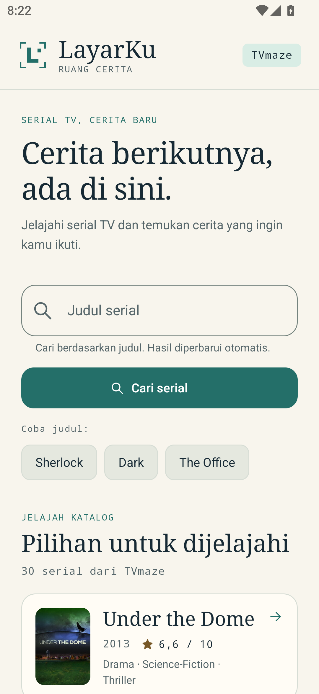
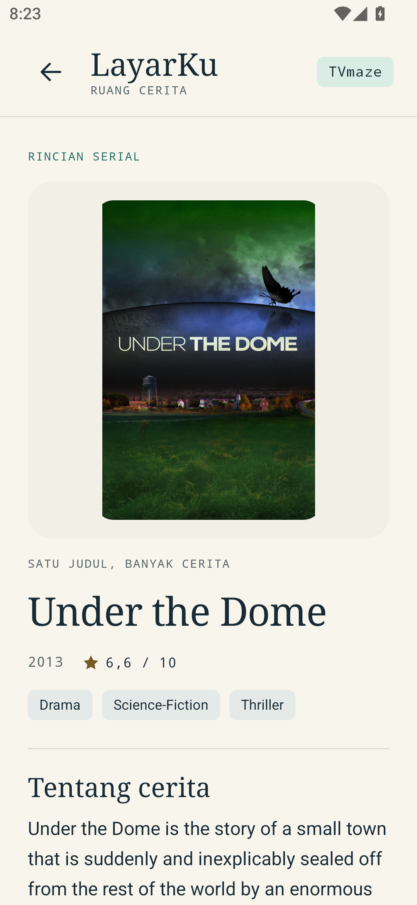

# LayarKu

LayarKu adalah aplikasi Android berbasis Kotlin untuk menjelajahi dan mencari serial televisi menggunakan [TVmaze API](https://www.tvmaze.com/api) publik. Aplikasi ini dibuat untuk tugas **Responsi Mobile A**. Antarmuka aplikasi dan README ini menggunakan bahasa Indonesia, sedangkan kode sumber menggunakan bahasa Inggris.

Tugas mencakup film maupun serial televisi. Karena TVmaze berfokus pada tayangan televisi, LayarKu tidak mengklaim menyediakan basis data film secara umum.

## Fitur

- Dua halaman: **Home** dan **Detail**.
- Daftar serial dari API, pencarian berdasarkan judul, dan daftar yang dapat digulir menggunakan `LazyColumn`.
- Pencarian otomatis dengan debounce serta pencarian langsung melalui tombol atau keyboard.
- Navigasi **Sebelumnya/Berikutnya** dengan maksimal 20 serial per halaman, tanpa daftar yang bertambah terus ke bawah.
- Filter genre pada seluruh data yang sudah dimuat, bukan hanya item yang terlihat atau seluruh katalog TVmaze.
- Saran **Coba judul** dari data API yang dipilih secara acak, dengan tombol **Acak lagi**.
- Judul, tahun rilis, rating, dan genre pada setiap item daftar.
- Halaman detail dengan sinopsis yang mudah dibaca serta informasi tambahan jika tersedia.
- Tampilan untuk kondisi memuat, hasil kosong, kesalahan, dan coba lagi, termasuk teks pengganti untuk data yang tidak tersedia.
- Skema warna terang/gelap Material 3 dan tipografi yang dikustomisasi.
- Arsitektur MVVM, coroutines, StateFlow, pengamatan state yang mengikuti lifecycle, dan dependency injection manual.
- Poster dari TVmaze pada katalog dan Detail, dengan cache gambar melalui Coil serta kartu inisial saat poster sedang dimuat, tidak tersedia, atau gagal dimuat.
- Tidak memerlukan akun atau API key.

Daftar penjelajahan berasal dari indeks tayangan TVmaze, **bukan** peringkat popularitas atau daftar yang sedang tren. Deskripsi tayangan tetap menggunakan bahasa yang disediakan oleh TVmaze.

## Tangkapan Layar dan GIF

Tangkapan layar Home dan Detail berikut diambil dari aplikasi yang berjalan di emulator, bukan gambar rancangan atau hasil rekayasa.

<p align="center">
  
  
</p>


## Build dan Menjalankan Aplikasi

1. Buka folder utama proyek di Android Studio yang kompatibel dengan **AGP 9.3.0**.
2. Gunakan JDK bawaan Android Studio untuk Gradle dan pasang Android SDK platform **37**.
3. Biarkan Android Studio membuat `local.properties` sesuai lokasi SDK di komputer masing-masing. Berkas ini sengaja diabaikan oleh Git.
4. Lakukan sinkronisasi Gradle, lalu jalankan konfigurasi `app` pada Android **10 / API 29** atau versi yang lebih baru.
5. Koneksi internet diperlukan untuk mengakses TVmaze. Tidak diperlukan kredensial rahasia atau API key.

Windows PowerShell:

```powershell
.\gradlew.bat :app:testDebugUnitTest :app:assembleDebug
```

macOS, Linux, atau Git Bash:

```bash
bash ./gradlew :app:testDebugUnitTest :app:assembleDebug
```

Hasil build: `app/build/outputs/apk/debug/app-debug.apk`.

Laporan unit test: `app/build/reports/tests/testDebugUnitTest/index.html`.

Gradle Wrapper menggunakan distribusi resmi Gradle 9.5.0 dengan checksum SHA-256. Sinkronisasi pertama dapat mengunduh Gradle dan dependensi. AGP 9 memiliki dukungan Kotlin bawaan; proyek ini tidak menggunakan plugin lama `org.jetbrains.kotlin.android`.

### Dependensi Utama

| Komponen | Versi |
| --- | --- |
| Android Gradle Plugin | 9.3.0 |
| Gradle | 9.5.0 |
| Plugin Kotlin Compose / serialization | 2.2.10 |
| Compose BOM | 2026.02.01 |
| Navigation Compose | 2.10.0 |
| Lifecycle | 2.9.4 |
| Retrofit | 3.0.0 |
| OkHttp / MockWebServer | 4.12.0 |
| Coil Compose / jaringan OkHttp | 3.3.0 |
| Kotlinx serialization | 1.9.0 |
| Kotlinx coroutines | 1.9.0 |

## Struktur MVVM

```text
app/src/main/java/com/hajun/layar/
├── MainActivity.kt          # Titik masuk aplikasi Android
├── LayarApplication.kt      # Wadah dependensi pada tingkat aplikasi
├── model/                  # Data class domain yang tidak dapat diubah
├── data/
│   ├── remote/             # Endpoint Retrofit dan DTO untuk serialisasi API
│   ├── ShowRepository.kt   # Kontrak repository
│   ├── DefaultShowRepository.kt
│   └── AppContainer.kt     # Dependency injection manual
└── ui/
    ├── LayarApp.kt         # NavHost dengan dua tujuan navigasi
    ├── home/               # Halaman Home, ViewModel, dan state UI
    ├── detail/             # Halaman Detail, ViewModel, dan state UI
    ├── components/         # Komponen tampilan yang dapat digunakan ulang
    └── theme/              # Warna dan tipografi Material 3 yang dikustomisasi
```

### Alur Data

```text
Input pengguna → Event Composable → ViewModel → Repository → Retrofit → TVmaze
                                        ↓
                                 StateFlow<UiState>
                                        ↓
                         Pengamatan state sesuai lifecycle
                                        ↓
                                Recomposition Compose
```

- **Model:** menyimpan data `Show` yang tidak dapat diubah. DTO API merepresentasikan struktur JSON dari server sehingga UI tidak bergantung langsung pada struktur tersebut.
- **Repository:** menjadi lapisan akses data untuk permintaan tayangan dan pemetaan respons API ke model aplikasi.
- **ViewModel:** mengelola permintaan, debounce, pembatalan, kondisi memuat, kesalahan, hasil, dan percobaan ulang melalui `viewModelScope`.
- **View:** menampilkan state dan meneruskan aksi pengguna. Composable tidak memanggil Retrofit secara langsung.
- **Navigation:** meneruskan ID tayangan bertipe integer, bukan seluruh objek respons API. ViewModel Detail dapat mengambil ulang data ketika dibuat kembali.
- **SavedStateHandle:** menyimpan query pencarian dan genre terpilih, serta menyediakan argumen ID untuk halaman Detail. Halaman aktif dan katalog termuat bertahan saat kembali dari Detail melalui ViewModel Home; setelah proses aplikasi dibuat ulang, data diambil kembali dari halaman awal.

Aplikasi dua halaman ini menggunakan dependency injection manual tanpa Hilt, Room, atau lapisan domain/use case tambahan.

## Penggunaan API

URL dasar: `https://api.tvmaze.com/`

| Operasi | Endpoint | Bentuk Respons |
| --- | --- | --- |
| Menjelajahi serial | `GET /shows?page=0` | Array objek tayangan |
| Mencari berdasarkan judul | `GET /search/shows?q=dark` | Array objek pembungkus `{ "score": ..., "show": ... }` |
| Memuat detail | `GET /shows/17861` | Satu objek tayangan |

### Pagination, Filter Genre, dan Saran Judul

- Batas katalog awal 30 tayangan telah dihapus. TVmaze mengirim maksimal 250 tayangan per halaman API, lalu aplikasi membaginya menjadi halaman tampilan berisi maksimal **20 serial**.
- Kontrol **Sebelumnya · 1 dari … · Berikutnya** tampil ringkas di akhir daftar pada setiap halaman, sebelum atribusi TVmaze. Kontrol ikut bergulir bersama daftar, bukan menempel pada layar. Perpindahan di antara halaman yang sudah dimuat tidak mengirim permintaan baru.
- Saat mencapai halaman lokal terakhir, **Berikutnya** mengambil satu bagian API selanjutnya (`page=1`, `page=2`, dan seterusnya). Katalog tidak diunduh seluruhnya di awal dan tidak disimpan di database.
- Jika halaman tampilan terakhir belum penuh, data baru melengkapinya terlebih dahulu agar tidak ada item yang terlewati. Tekan Berikutnya lagi untuk melanjutkan.
- HTTP 404 dari indeks katalog menandai akhir data. Respons sukses yang pendek atau kosong bukan penanda akhir karena halaman TVmaze berbasis ID.
- Genre disaring dari **seluruh data aktif yang sudah dimuat sebelum pagination**. Pilihan genre dan jumlah halaman mengikuti data tersebut; UI tidak mengklaim jumlah total seluruh TVmaze.
- Jika bagian baru belum memiliki genre yang cocok, aplikasi memberi keterangan dan menunggu aksi Berikutnya. Tidak ada pengunduhan berulang otomatis untuk mencari kecocokan.
- Pencarian judul tetap menggunakan API dan mempertahankan urutan relevansi. Hasilnya difilter serta dibagi menjadi halaman secara lokal; tidak ada parameter halaman tambahan pada endpoint pencarian.
- Saran judul berisi hingga tiga judul unik dari data aktif yang sudah dimuat. Saran dipilih setelah pemuatan sumber data atau melalui **Acak lagi**, bukan setiap recomposition, perpindahan halaman, atau perubahan genre.
- Kesalahan pengambilan bagian berikutnya tidak menghapus hasil yang sudah ada. **Coba lagi** mengulang permintaan bagian yang sama.

### Pemetaan Data dan Penanganan Nilai Null

| Field API | Penggunaan pada UI/Model |
| --- | --- |
| `id` | Kunci stabil untuk daftar dan argumen navigasi Detail |
| `name` | Judul tayangan |
| `premiered` | Tahun rilis, dengan teks pengganti jika tidak tersedia |
| `rating.average` | Rating, dengan teks pengganti jika tidak tersedia |
| `genres` | Daftar genre, dengan teks pengganti jika kosong |
| `summary` | Sinopsis; HTML diubah menjadi teks yang mudah dibaca |
| `image.medium` / `image.original` | Poster katalog / Detail; URL kosong atau tidak valid diabaikan |
| `network` / `webChannel` | Stasiun televisi atau platform, jika tersedia |
| `language`, `status`, `type`, `runtime` | Informasi tambahan pada halaman Detail |

Kotlin serialization mengabaikan field yang tidak dikenali. Retrofit melakukan encoding pada parameter query pencarian. OkHttp menerapkan batas waktu koneksi dan permintaan. Pembatalan coroutine diteruskan tanpa ditampilkan sebagai kesalahan, dan respons pencarian lama tidak boleh menggantikan hasil pencarian yang lebih baru.

TVmaze memiliki batas frekuensi permintaan. Aplikasi menggunakan debounce agar tidak mengirim permintaan untuk setiap karakter yang diketik. Permintaan yang gagal menampilkan aksi coba lagi, bukan indikator memuat tanpa akhir. Aplikasi bukan basis data offline; data di memori tidak bertahan setelah proses aplikasi berakhir.

Poster dimuat secara asinkron melalui Coil, dengan cache memori dan disk. Katalog mengutamakan gambar `medium`, sedangkan Detail mengutamakan `original`; jika salah satu URL tidak tersedia, ukuran lainnya digunakan. Hanya URL HTTPS yang valid diterima. Kartu inisial menjadi tampilan pengganti selama pemuatan atau jika gambar gagal dimuat, tanpa menghalangi informasi serial. Coil 3.3.0 dipilih agar kompatibel dengan toolchain Kotlin proyek ini.

Atribusi data: [TVmaze](https://www.tvmaze.com/), tersedia dengan lisensi [CC BY-SA](https://www.tvmaze.com/api#licensing). LayarKu merupakan proyek tugas kuliah independen dan tidak berafiliasi dengan TVmaze.

## Pengujian

Unit test JVM menggunakan repository tiruan, dispatcher coroutine khusus pengujian, dan MockWebServer agar hasilnya deterministik tanpa memanggil API publik. Pengujian mencakup pemetaan data, permintaan jaringan, dan perilaku state ViewModel. Jalankan perintah pengujian di atas untuk melihat hasil terkini; status pengujian dan build tidak boleh diasumsikan hanya dari README ini.

Perilaku pada emulator/perangkat dan tampilan visual perlu diperiksa secara manual. Lihat [SUBMISSION.md](docs/SUBMISSION.md) dan [VIDEO_GUIDE.md](docs/VIDEO_GUIDE.md).
